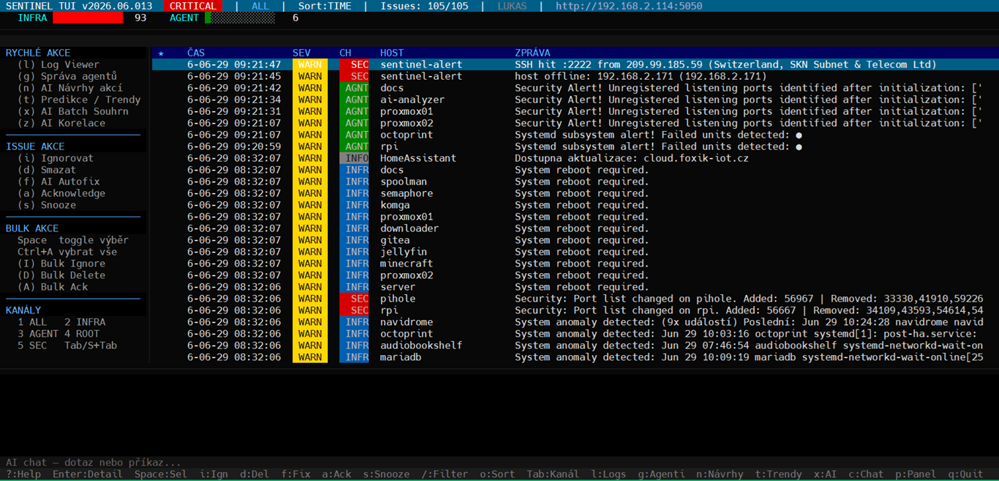

# Sentinel Console



**TUI terminal client for Sentinel Commander.**

Sentinel Console is an HTOP-style terminal dashboard with full feature parity with the Sentinel web UI. Built on [Textual](https://textual.textualize.io/) + `httpx`.

```
┌─ SENTINEL TUI v3.0 ─ [WARNING] ─ INFRA ─ Issues: 65/98 ───────────────┐
│  INFRA ████████████  63   AGENT ░░░░░░░░   2                            │
│  ROOT  ░░░░░░░░░░░░   0   SEC   ██░░░░░░   3    TOTAL: 98               │
├─────────────────────────────────────────────────────────────────────────┤
│ QUICK ACTIONS  │ ★   TIME              SEV    HOST         MESSAGE       │
│ (l) Log Viewer │ ×3  2026-06-13 23:44  CRIT   web-01       nginx fail   │
│ (g) Agents     │ ACK 2026-06-13 23:41  HIGH   hpc-node-04  CPU >95%    │
│ (n) AI Hints   │     2026-06-13 23:38  WARN   gateway-01   sudo opened  │
│ (f) AI Autofix │     2026-06-13 23:35  WARN   fw-01        port scan    │
└─────────────────────────────────────────────────────────────────────────┘
```

---

## Features

- Full issue list with severity filters, sort, acknowledge, snooze, delete
- AI Autofix — trigger and confirm SSH remediations from terminal
- AI Chat — streaming conversation with Sentinel LLM
- Agent list with health scores and telemetry
- Log viewer with live tail
- Trends, AI suggestions, AI correlation
- Keyboard-driven — no mouse required

---

## Quick Start

### Requirements

- Python 3.13+
- Running [Sentinel Commander](https://github.com/foxik0070/Sentinel) instance

### Install

```bash
git clone https://github.com/foxik0070/sentinel-console
cd sentinel-console
pip install textual httpx
python sentinel_client_init.py   # configure server URL + credentials
```

### Run

```bash
python sentinel_client.py
```

### Key bindings

| Key | Action |
|---|---|
| `q` | Quit |
| `r` | Refresh |
| `f` | AI Autofix on selected issue |
| `a` | Acknowledge |
| `s` | Snooze |
| `d` | Delete |
| `l` | Log viewer |
| `g` | Agent list |
| `n` | AI suggestions |
| `Tab` | Switch category filter |

---

## Documentation

Full documentation: **https://sentinel-docs.example.com**

---

## Related

- [Sentinel Commander](https://github.com/foxik0070/Sentinel) — backend server
- [sentinel-app](https://github.com/foxik0070/sentinel-app) — Android mobile client

---

## License

MIT — see [LICENSE](LICENSE). Copyright © 2026 foxik0070.
